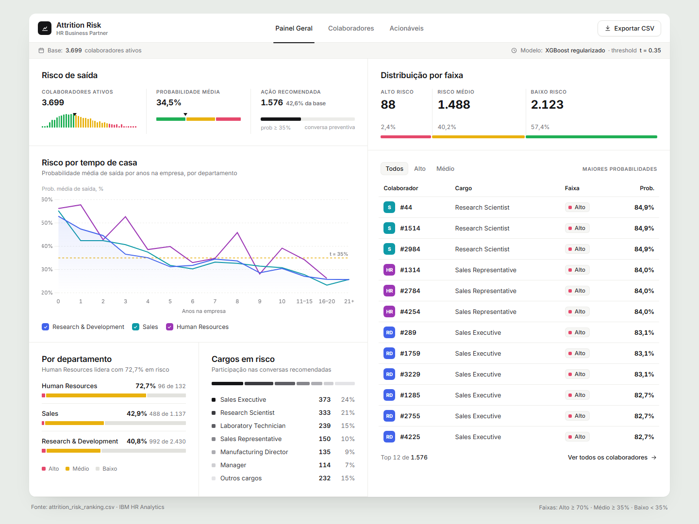
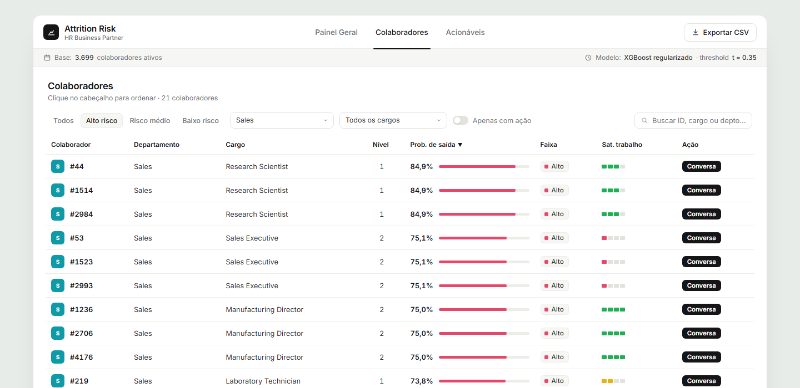
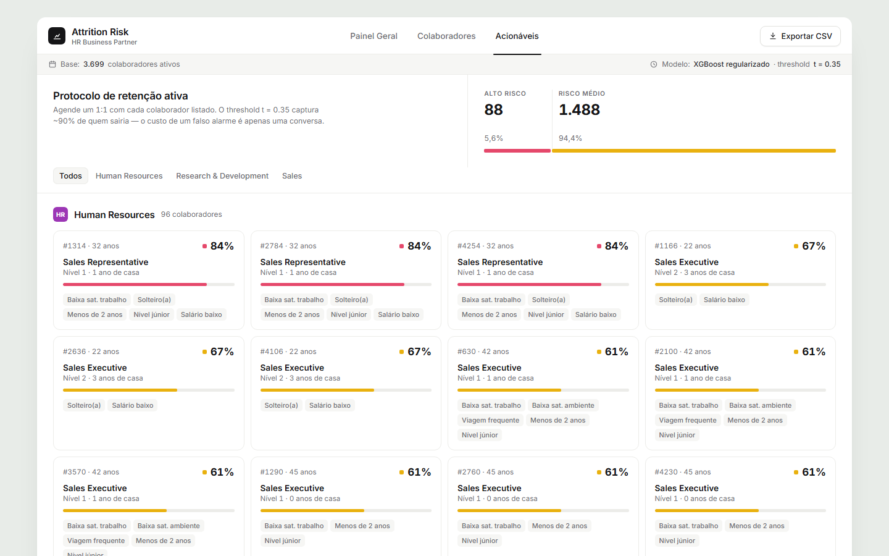
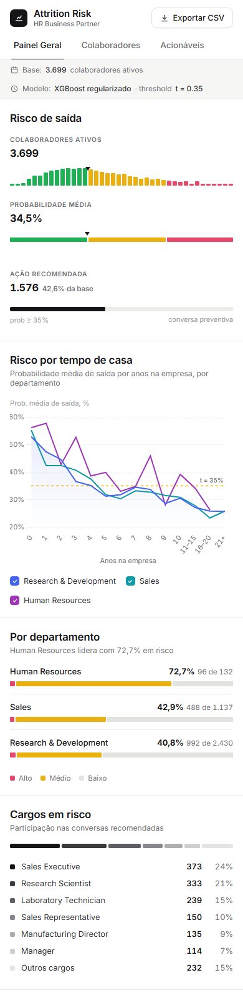

# Employee Attrition — Predictive Model & HR Dashboard

Predictive modeling pipeline to identify flight-risk employees, with an operational dashboard for HR Business Partners.



**Dataset:** IBM HR Analytics (Kaggle) — 4,410 employees, 24 features  
**Model:** XGBoost with regularization to prevent overfitting on the synthetic data  
**Threshold:** t = 0.35 — captures ~90% recall at ~25–30% precision (asymmetric cost: conversation is cheap, losing talent is not)

---

## Project Structure

```
notebooks/
  01_predictive_model.ipynb   — Logistic Regression, Random Forest, XGBoost + SHAP explainability
  02_risk_ranking.ipynb       — Scores every active employee, generates risk ranking CSV

data/raw/
  general_data.csv            — Main HR dataset
  employee_survey_data.csv    — Job & environment satisfaction
  manager_survey_data.csv     — Manager ratings
  attrition_risk_ranking.csv  — Output: ranked employees with risk score & action flag

dashboard/
  bp_attrition_dashboard.html — Self-contained interactive dashboard for HR BPs

scripts/
  gen_bp_dashboard.py         — Regenerates the dashboard from ranking CSV

images/
  overview.png, filters.png, actions.png, mobile.png — Dashboard screenshots
```

---

## Notebooks

### 01 — Predictive Model

- Feature engineering & leakage audit (24 features)
- Three models: Logistic Regression · Random Forest · XGBoost
- Class imbalance handling via `scale_pos_weight`
- Regularized XGBoost config: `max_depth=3, learning_rate=0.05, subsample=0.8, colsample_bytree=0.8, min_child_weight=5, reg_alpha=1.0, reg_lambda=2.0`
- Gap diagnostic (train vs. test ROC-AUC) to flag overfitting
- Early stopping with manual preprocessor clone
- SHAP TreeExplainer for global + local interpretability
- Threshold analysis with asymmetric cost framing

### 02 — Risk Ranking

- Retrains regularized XGBoost on full dataset
- Scores all active employees with probability of attrition
- Classifies into risk tiers: Alto (≥70%) · Médio (≥35%) · Baixo (<35%)
- Per-department × per-role breakdown
- Exports `attrition_risk_ranking.csv`

---

## HR Dashboard

`dashboard/bp_attrition_dashboard.html` — open in any browser, no server needed. The interface is in Portuguese, built for Brazilian HR Business Partners.

**Tabs:**
- **Painel Geral** (overview)
  - Headline KPIs with micro-charts: probability distribution with the t = 0.35 marker, average risk gauge, share flagged for action
  - Risk-tier distribution and the 12 highest-risk employees
  - **Risk by tenure** — average attrition probability by years at the company, per department (toggle each line)
  - Risk by department (stacked tiers) and the roles that concentrate recommended conversations
- **Colaboradores** (employees) — filter by tier, department, role and "action only", free-text search, sortable columns, pagination
- **Acionáveis** (actionable) — one card per employee flagged for a preventive conversation, with probability and risk factors, grouped and filterable by department

**Export:** the *Exportar CSV* button downloads the current employee filter as a spreadsheet-ready CSV.

**Tech:** Vanilla JS · Chart.js · Google Fonts · all data embedded as JSON — zero build step, zero backend. Department colors are validated for color-vision deficiency; risk tiers are always labeled, never color-only.

To regenerate it after re-running the ranking notebook:

```bash
python scripts/gen_bp_dashboard.py
```

### Screenshots

| Employees — filtered (high risk · Sales) | Actionable cards |
|:---:|:---:|
|  |  |

<p align="center">
  <br>
  <sub>Responsive layout on a phone</sub>
</p>

---

## Results

| Model | ROC-AUC | PR-AUC |
|---|---|---|
| Logistic Regression | ~0.82 | — |
| Random Forest | ~0.87 | — |
| **XGBoost (regularized)** | **~0.89** | — |

At t = 0.35: ~90% recall · ~25% precision · 1,576 employees flagged for action out of 3,699 active.

---

## Setup

```bash
pip install pandas numpy scikit-learn xgboost shap matplotlib seaborn
jupyter notebook
```

---

*Part of a broader HR Analytics portfolio — EDA phase: [employee-attrition](https://github.com/lorennapaiss/employee-attrition)*
